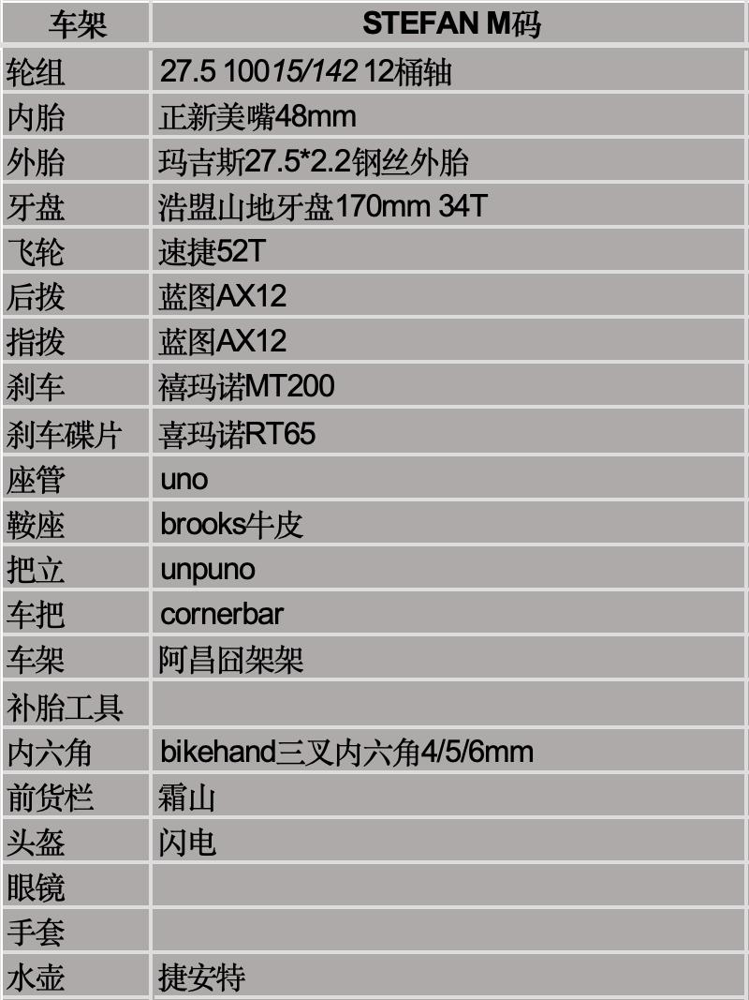

## **个人系统**
- 📱手机：捕捉想法，44记录梦境
- 📓A6 personal本子：追踪我的保底完成事项。（记账，体重，入睡时间，锻炼，戒色，刷牙）
- 📄 A4纸：愿景，项目，项目微习惯，基本日程表
- 🖥 Notion：保存已经被我整理、思考和验证过的人生资产(书影音游库，兴趣主题，项目，网站草稿，愿景，年计划，月计划)
- 🌐 网站：把已经验证过的方法，经验，技巧传播出去

## **硬件**
2026-10-10更新,我总是频繁更新我的电子产品,但我会试着将更新频率降下来.

- mini主机：[铭凡um790pro](https://www.minisforum.cn/)
- 笔记本电脑：[Mac book Air M5](https://www.apple.com/)
- 笔记本支架：[联想小新Z1](https://www.lenovo.com.cn/)
- 显示器：暂无
- 机械硬盘：[希捷酷鹰4T](https://www.seagate.com/)
- 机械键盘： [rk r65静音轴](https://www.rkgaming.com/)。lelelaby2k76好看,后续会购买一个收藏.
- 鼠标：[ATK烈空F1pro max](https://www.atk.store/)，很轻，很好用
- 耳机：[earpods](https://www.apple.com/)
- 手机: [iphone17](https://www.apple.com/)
- 电纸书：[文石NOTEx5](https://boox.com/)—>[掌阅ocean5p](https://www.ireader.com/)->纸质.随着我对人生困惑的逐渐消解,没有那么多问题需要通过阅读来解决.慢慢的我改成了阅读纸质书,一是为了便宜的阅读,二是为了收藏.我认为人是应该有个收集类型的爱好的.如果不想买书,也可以办一张当地的免费图书证.
- 手柄：[魔派N1HD](https://www.mobapad.com/)
- 游戏主机：我将自己的[NS](https://www.nintendo.com/)卖掉了.随着年龄的增长,我对游戏的热情逐渐灭掉.我已经基本不完游戏了.
- 打印机：Epson L3250 Series
- 钢笔：金豪52
- 自行车： 

## **网络服务**

- 域名：[腾讯云](https://cloud.tencent.com/)，[阿里云](https://www.aliyun.com/)，反正各个云新人注册都很便宜，不到10块注册一年。
- 代码托管：[Github](https://github.com/)
- 建站工具：[Astro](https://astro.build/)
- 网站托管：[Netlify](https://www.netlify.com/)
- 打字练习：[dazidazi](https://dazidazi.com/)真的很好用
- 过墙梯：ESNC,便宜好用，但需要在先过墙才能买😂。泰山便宜，但高峰期不稳定。#备用
- 软件用的是[clash verge](https://github.com/clash-verge-rev/clash-verge-rev)
- AI：[Chatgpt](https://chatgpt.com/)

## **应用**

- 浏览器：[Google Chrome](https://www.google.com/chrome/)
- [nvim](https://neovim.io/)是我最常使用的编辑器,准确来说是[Lazyvim](https://www.lazyvim.org/)。
- [Sublime Text4](https://www.sublimetext.com/) 我也蛮喜欢的。
- 笔记软件我用的是[Obsidian](https://obsidian.md/)
- 代码编辑器: [vscode](https://code.visualstudio.com/)

