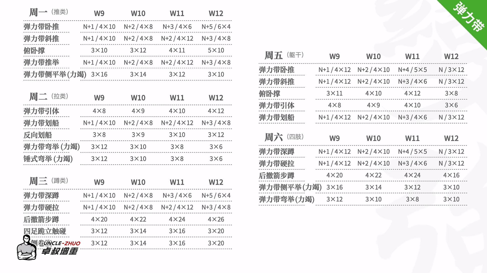
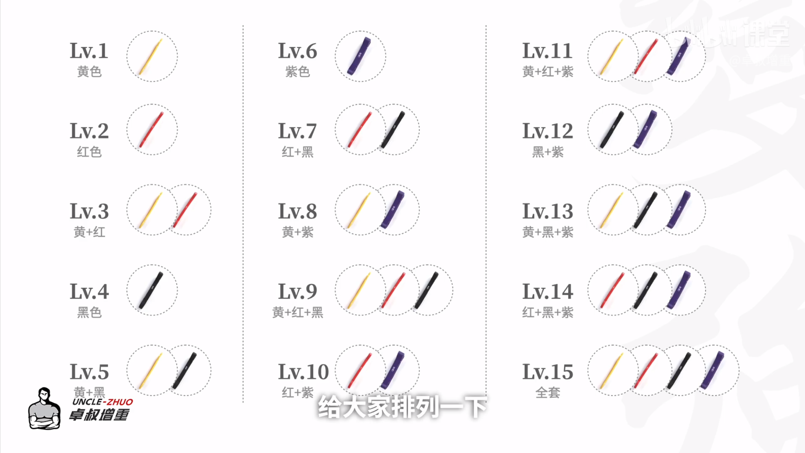

这是我能控制的最小环境，也是保底环境。其他什么都可以不进行，不维护，但这部分在任何时候都是第一优先级维护

## 锻炼计划
我使用弹力带一周五练。
训练计划如下

## 饮食计划
目标体重80kg
每kg体重碳水7g，蛋白质2g
2026/3/27 体重70kg 需每日摄入490g碳水，140g蛋白质
早餐：三个馒头+一碗豆类汤/蛋白粉一勺+两个鸡蛋（碳水：190.5+  蛋白质：41+）
午餐：一份200g的挂面+3个鸡蛋  （碳水154.5  蛋白质：57）
晚餐：一个馒头+一个鸡蛋+100g赠机粉  （碳水：132  蛋白质：37）
总计：477g碳水，135g蛋白质
2026/6/29体重    73.1kg每日摄入496g碳水，146g蛋白质
2026/7/27体重     75kg 需摄入150g蛋白质，525g碳水
每日六个馒头480g, 6个鸡蛋，200g挂面，30g蛋白粉100g增肌粉。
早餐（八点半）：馒头3个，鸡蛋2个，增肌粉50g
上午加餐（11：00）：馒头1个
练后：蛋白30g,增肌粉50g
午餐（13：00）：挂面100g,鸡蛋3个 
下午加餐（16：00）：馒头1个
晚餐：挂面100g,鸡蛋1个

2026/10/10 体重75kg稳定 需每日摄入碳水225g，蛋白质150g蛋白质（3倍碳水）也是最低摄入标准。增肌为5倍碳水

## 睡眠方法
我采取的睡眠方法是19:00开始做饭吃饭，这顿是高碳水饮食，吃完半小时后开始晕碳，正好困了，一般在八点半左右开始睡觉。等到半夜两三点自然醒之后开始完成该阶段的项目，之后大概五六点有开始困。睡到八点起床吃早饭。